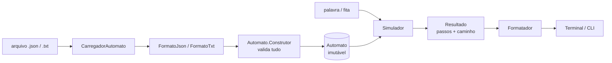
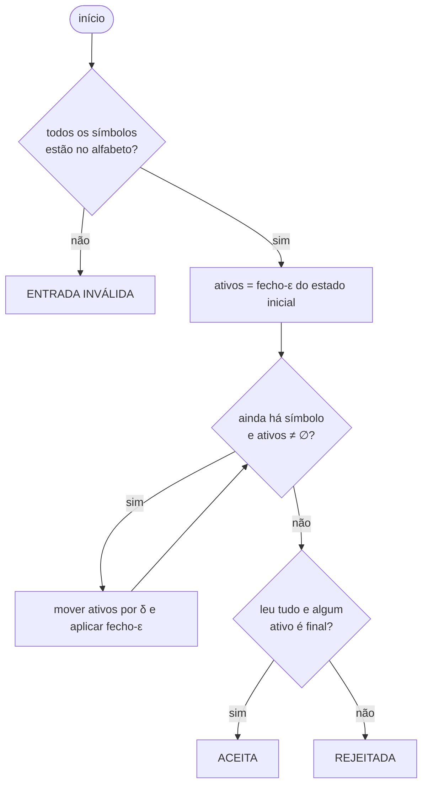
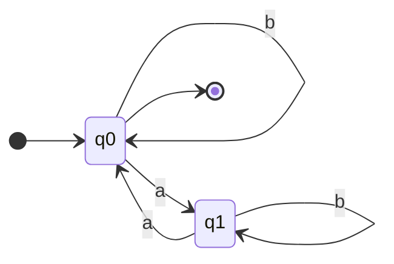
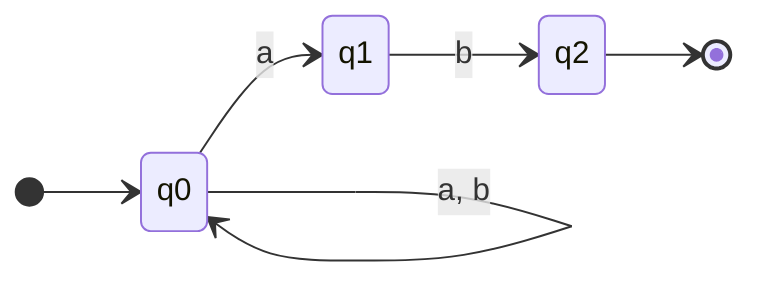
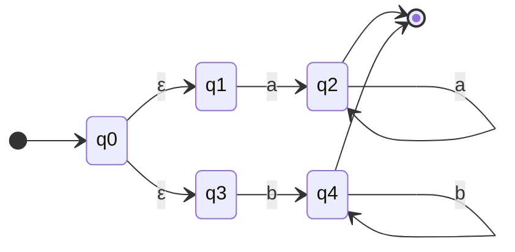

# Simulador de Autômatos Finitos (AFD / AFND / AFND-ε)

Trabalho de **Computabilidade** — Opção A: simulador de Autômato Finito Determinístico (AFD) ou Não Determinístico (AFND).

O programa lê a especificação formal de um autômato **M = (Q, Σ, δ, q0, F)** de um arquivo `.json` ou `.txt`, recebe uma palavra (a "fita") e processa **passo a passo**, mostrando os estados ativos, o caminho percorrido e se a palavra foi **aceita** ou **rejeitada**.

Funciona para AFD, AFND e AFND com transições vazias (ε), com o mesmo algoritmo.

---

## 1. Requisitos

- **JDK 17 ou superior** (testado com o JDK 21). Não há dependências externas.
- Terminal com UTF-8 (para exibir `ε`, `δ`, `∅`).

## 2. Como compilar e executar

**Linux / macOS** (na pasta do projeto):

```bash
./compilar.sh                                   # compila para a pasta out/
./executar.sh exemplos/validos/afnd_termina_em_ab.json aab
./testar.sh                                     # roda a bateria de testes
```

**Qualquer sistema (comandos diretos)**:

```bash
# compilar
javac -encoding UTF-8 -d out $(find src/main -name '*.java')

# executar
java -cp out automato.cli.Main <automato.json|txt> [opções] [palavra ...]
```

> No **Windows** (PowerShell/CMD): rode `dir /s /b src\main\*.java > fontes.txt`, depois `javac -encoding UTF-8 -d out @fontes.txt`, e use `chcp 65001` antes de executar para o console mostrar `ε` corretamente.

### Opções da linha de comando

| Opção | O que faz |
|---|---|
| `<palavra> ...` | Palavras a processar (use `""` ou `ε` para a **palavra vazia**) |
| `-f, --arquivo-palavras <arq>` | Lê as palavras de um arquivo, uma por linha (linhas em branco são ignoradas; `ε` = palavra vazia) |
| `-i, --interativo` | Modo interativo: digite palavras uma a uma (`:info`, `:ajuda`, `:q`) |
| `-q, --silencioso` | Mostra só `ACEITA` / `REJEITADA` por palavra (sem o passo a passo) |
| `-h, --ajuda` | Mostra a ajuda |
| `--` | Fim das opções (para palavras que começam com `-`) |

Sem nenhuma palavra na linha de comando, o programa entra no **modo interativo**.

**Códigos de saída:** `0` = todas aceitas · `1` = alguma rejeitada · `2` = erro (arquivo inválido, uso incorreto ou palavra com símbolo fora do alfabeto).

---

## 3. Estrutura de arquivos

```
automato-simulador/
├── MANUAL.md                      este manual
├── compilar.sh  executar.sh  testar.sh
├── src/
│   ├── main/java/automato/
│   │   ├── modelo/                Automato (modelo + validação), AutomatoInvalidoException
│   │   ├── entrada/               CarregadorAutomato, FormatoJson, FormatoTxt, LeitorJson
│   │   ├── simulacao/             Simulador, Resultado, Passo, Movimento
│   │   └── cli/                   Main, Opcoes, Formatador
│   └── test/java/automato/        TestesAutomato (98 verificações, sem JUnit)
└── exemplos/
    ├── validos/                   autômatos de exemplo + palavras_afnd.txt
    └── invalidos/                 arquivos malformados para demonstrar o tratamento de erros
```

### Arquitetura



Cada camada tem uma responsabilidade: **entrada** lê e converte arquivos; **modelo** garante que um autômato só existe se for válido; **simulação** executa o algoritmo; **cli** só cuida de argumentos e de formatar a saída.

---

## 4. Formato dos arquivos de entrada

Cada símbolo do alfabeto tem **exatamente 1 caractere**. O símbolo `ε` (ou `λ`, `eps`, `epsilon`, `lambda`) representa a **transição vazia** e não pode fazer parte do alfabeto.

### 4.1 JSON (`.json`)

```json
{
  "estados":    ["q0", "q1", "q2"],
  "alfabeto":   ["a", "b"],
  "inicial":    "q0",
  "finais":     ["q2"],
  "transicoes": [
    {"de": "q0", "simbolo": "a", "para": ["q0", "q1"]},
    {"de": "q0", "simbolo": "b", "para": ["q0"]},
    {"de": "q1", "simbolo": "b", "para": ["q2"]}
  ]
}
```

- `para` pode ser uma lista (vários destinos = não determinismo) ou um texto só (`"para": "q1"`).
- Todos os campos são obrigatórios (`finais` e `transicoes` podem ser listas vazias).

### 4.2 Texto (`.txt`)

```
# comentário (só vale se o # for o primeiro caractere da linha; não use comentário no meio da linha)
estados: q0 q1 q2
alfabeto: a b
inicial: q0
finais: q2
transicoes:
q0 a q0 q1
q0 b q0
q1 b q2
# transição vazia: <origem> ε <destino>
q1 ε q0
```

Cada linha de transição é `<origem> <símbolo> <destino> [<destino> ...]` (também é aceito `q0 a -> q1`).

---

## 5. Como a simulação funciona

O simulador usa o mesmo algoritmo para AFD e AFND: mantém o **conjunto de estados ativos**.

1. **Passo 0:** ativos = fecho-ε({q0}), isto é, o estado inicial mais tudo que se alcança só por transições ε.
2. **A cada símbolo `c` lido:** move todos os estados ativos por `δ(q, c)`, junta os destinos e aplica o fecho-ε.
3. **Fim da fita:** a palavra é **aceita** se algum estado ativo é final; caso contrário, **rejeitada**.
4. Se o conjunto de ativos **fica vazio**, a execução para (o autômato "travou") e a palavra é rejeitada.

Num **AFD** o conjunto ativo tem sempre no máximo 1 estado, então a execução é o caminho único do autômato. No **AFND**, o programa guarda de onde cada estado veio e reconstrói **um caminho aceitador** ao final.



---

## 6. Exemplos de testes bem-sucedidos

Os autômatos de exemplo ficam em `exemplos/validos/`.

### 6.1 AFD — quantidade par de `a` (`afd_pares_de_a.json`)



```
$ ./executar.sh exemplos/validos/afd_pares_de_a.json -q "" a aa
ε: ACEITA
"a": REJEITADA
"aa": ACEITA
Resumo: 2 aceita(s), 1 rejeitada(s), 0 inválida(s) — 3 palavra(s).
```

### 6.2 AFD — binários múltiplos de 3 (`afd_binario_multiplo_de_3.json`)

Os estados `r0`, `r1`, `r2` guardam o resto da divisão por 3 do número lido até agora.

```
$ ./executar.sh exemplos/validos/afd_binario_multiplo_de_3.json -q 110 111 0 ""
"110": ACEITA          (6 é múltiplo de 3)
"111": REJEITADA       (7 não é)
"0": ACEITA
ε: ACEITA
```

### 6.3 AFND — palavras que terminam em `ab` (`afnd_termina_em_ab.json` / `.txt`)



```
$ ./executar.sh exemplos/validos/afnd_termina_em_ab.json aab
Palavra: "aab" (3 símbolos)
  Passo 0 — estado inicial
     ativos: {q0}
  Passo 1 — lê 'a'   (fita: a|ab)
     δ(q0, a) = {q0, q1}
     ativos: {q0, q1}
  Passo 2 — lê 'a'   (fita: aa|b)
     δ(q0, a) = {q0, q1}
     δ(q1, a) = ∅
     ativos: {q0, q1}
  Passo 3 — lê 'b'   (fita: aab|)
     δ(q0, b) = {q0}
     δ(q1, b) = {q2}
     ativos: {q0, q2}
  Estados ativos ao final  : {q0, q2}
  Estados finais atingidos : {q2}
  Caminho aceitador        : q0 --a--> q0 --a--> q1 --b--> q2
Resultado: ACEITA
```

### 6.4 AFND com transições ε — `a⁺` ou `b⁺` (`afnd_epsilon_a_mais_ou_b_mais.json`)



Palavra **rejeitada** (`ab`): o conjunto de estados ativos esvazia e a execução para.

```
$ ./executar.sh exemplos/validos/afnd_epsilon_a_mais_ou_b_mais.json ab
Palavra: "ab" (2 símbolos)
  Passo 0 — estado inicial
     fecho-ε: q0 --ε--> q1, q0 --ε--> q3
     ativos: {q0, q1, q3}
  Passo 1 — lê 'a'   (fita: a|b)
     δ(q0, a) = ∅
     δ(q1, a) = {q2}
     δ(q3, a) = ∅
     ativos: {q2}
  Passo 2 — lê 'b'   (fita: ab|)
     δ(q2, b) = ∅
     ativos: ∅
  Obs.: nenhum estado ativo após ler 2 símbolo(s) — não há transição possível
  Estados ativos ao final  : ∅
  Estados finais atingidos : ∅
Resultado: REJEITADA
```

### 6.5 Várias palavras de um arquivo

```
$ ./executar.sh exemplos/validos/afnd_termina_em_ab.json -q -f exemplos/validos/palavras_afnd.txt
```

### 6.6 Modo interativo

```
$ ./executar.sh exemplos/validos/afnd_termina_em_ab.txt
palavra> ab
...
palavra> :q
```

---

## 7. Robustez: entradas inválidas e arquivos malformados

O programa **não termina com exceção**: todo problema vira uma mensagem clara e um código de saída `2`. Quando há vários problemas no mesmo arquivo, **todos são listados de uma vez**.

| Situação | Comportamento |
|---|---|
| Arquivo inexistente, é um diretório ou ilegível | `arquivo não encontrado: ...` |
| Extensão diferente de `.json` / `.txt` | `extensão não suportada` |
| Arquivo vazio ou só com espaços | `o arquivo está vazio` |
| Arquivo que não está em UTF-8 | pede para salvar em UTF-8 |
| JSON malformado (vírgula faltando, aspas abertas, lixo no fim...) | `JSON malformado (linha L, coluna C): ...` |
| Campo obrigatório ausente, campo desconhecido ou repetido | nomeia o campo |
| Alfabeto escrito sem aspas (`[0, 1]`) | sugere `use "0" com aspas` |
| Símbolo com mais de 1 caractere, repetido ou igual a `ε` | erro no alfabeto |
| Estado inicial / final / origem / destino que não existe | cita o estado e a transição |
| Símbolo de transição fora do alfabeto | cita o símbolo e o alfabeto |
| `.txt` com linha inválida | cita o número da linha |
| **Palavra** com símbolo fora do alfabeto | `ENTRADA INVÁLIDA`, informando símbolo e posição |
| Palavra vazia | tratada normalmente (`""` ou `ε`) |
| AFD parcial (sem transição para o símbolo lido) | rejeita e explica onde travou |
| Ciclos de transições ε | não travam o simulador |

Exemplos (arquivos em `exemplos/invalidos/`):

```
$ ./executar.sh exemplos/invalidos/transicao_estado_inexistente.json a
Erro ao carregar o autômato 'exemplos/invalidos/transicao_estado_inexistente.json':
  - o estado final 'q7' não está no conjunto de estados
  - transição #1: estado de destino 'q5' não existe

$ ./executar.sh exemplos/invalidos/json_malformado.json
Erro ao carregar o autômato 'exemplos/invalidos/json_malformado.json':
  - JSON malformado (linha 4, coluna 3): era esperado ',' ou '}' mas foi encontrado '"'

$ ./executar.sh exemplos/validos/afnd_termina_em_ab.json abx
Palavra: "abx" (3 símbolos)
  Erro: o símbolo 'x' (posição 3 da palavra) não pertence ao alfabeto {a, b}
Resultado: ENTRADA INVÁLIDA
```

---

## 8. Testes automatizados

`./testar.sh` compila e executa `TestesAutomato`, uma bateria sem dependências externas com **98 verificações**:

- AFD: palavras aceitas/rejeitadas, vazia, e os 200 primeiros números binários conferidos contra `n % 3`.
- AFND e AFND-ε: aceitação, rejeição, palavra vazia, **ciclo de ε** e reconstrução do caminho aceitador.
- Carregamento: JSON e TXT equivalentes dão o mesmo veredito; BOM; diretivas em maiúsculas.
- Arquivos inválidos: mais de 25 casos de erro (JSON malformado, campos, estados, símbolos, UTF-8, vazio...).
- CLI: códigos de saída, `-q`, `-f`, modo interativo, opções inválidas.

## 9. Limitações conhecidas

- Símbolos do alfabeto têm exatamente 1 caractere e não podem ser espaço em branco.
- Os estados são identificados por nome (texto); nomes diferentes que só variam em maiúsculas/minúsculas são estados diferentes.
- Não há interface gráfica: a demonstração do passo a passo é feita no terminal.
